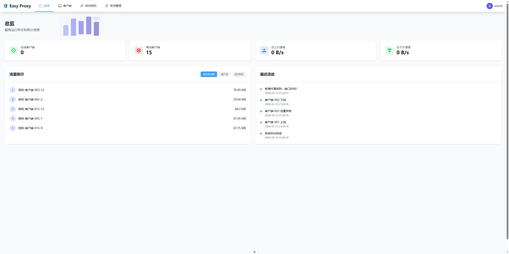
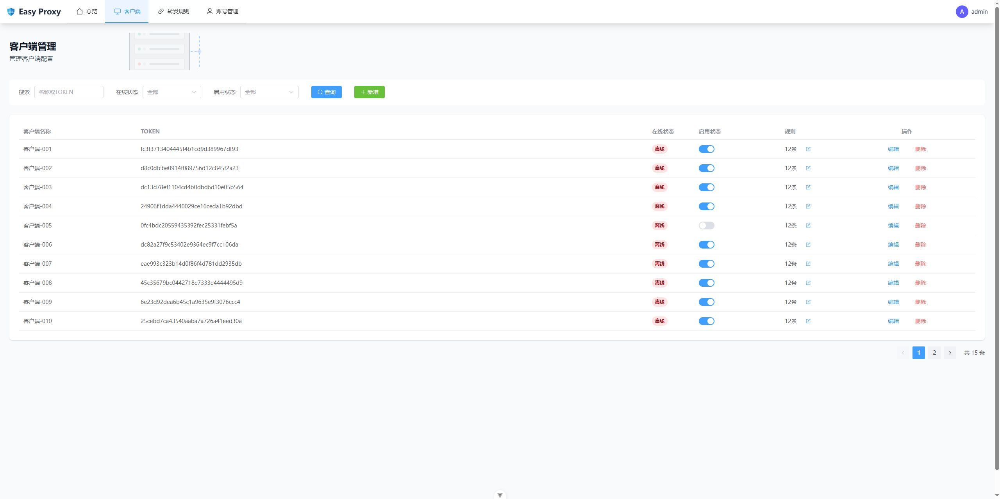

[English](./README_en.md) | 中文

## Easy Proxy

Easy Proxy 是一个基于 Java 25 原生 NIO 和 HttpServer 开发的高性能内网穿透工具，支持 TCP 流量转发。它包含服务端、客户端和 Web 管理界面，旨在提供简单易用的内网穿透服务。

<p align="center">
  
</p>

## 软件截图

<p align="center">
  
  
</p>

## 核心功能

| 功能        | 描述                                              | 支持情况  |
| :---------- | :------------------------------------------------ | :---- |
| **TCP内网穿透** | 基于Java原生NIO及虚拟线程，实现高性能TCP流量转发，支持双向数据透传，适用于各种TCP应用场景 | ✅ 已支持 |
| **TLS加密传输** | 服务端与客户端通信支持TLS加密，自动生成/下载证书，防止数据在传输过程中被窃听或篡改       | ✅ 已支持 |
| **流控管理**    | 支持基于规则的带宽限制（KB/s）和连接数限制，采用令牌桶算法，精准控制流量速率，防止滥用     | ✅ 已支持 |
| **流量分析**    | 提供多维度的流量统计，支持连接数监控与历史报表查询，帮助用户了解流量趋势      | ✅ 已支持 |
| **端口动态管理**  | 支持Web端动态申请/释放端口，实时生效，无需重启服务，灵活应对业务变化              | ✅ 已支持 |
| **多账号管理**   | 支持多用户管理，提供可视化用户管理界面，保障系统安全性                       | ✅ 已支持 |

## Docker快速部署

镜像必须使用固定测试标签。下例中的 `EASY_PROXY_VERSION` 需要替换为实际构建标签，不得使用浮动标签。

### 服务端部署

```bash
export EASY_PROXY_VERSION=test-20261122-000000-abcdef0
export EASY_PROXY_REGISTRY=registry.cn-hangzhou.aliyuncs.com/ckyspace

docker pull ${EASY_PROXY_REGISTRY}/easy-proxy-server:${EASY_PROXY_VERSION}
docker rm -f easy-proxy-server
docker run -d \
  --name easy-proxy-server \
  --network host \
  --restart always \
  -v $(pwd)/server/server.yaml:/app/server.yaml:ro \
  -v $(pwd)/server/config:/app/config \
  -v $(pwd)/server/data:/app/data \
  -v $(pwd)/server/logs:/app/logs \
  ${EASY_PROXY_REGISTRY}/easy-proxy-server:${EASY_PROXY_VERSION}

# Web 管理界面
docker pull ${EASY_PROXY_REGISTRY}/easy-proxy-web:${EASY_PROXY_VERSION}
docker rm -f easy-proxy-web
docker run -d \
  --name easy-proxy-web \
  --network host \
  --restart always \
  ${EASY_PROXY_REGISTRY}/easy-proxy-web:${EASY_PROXY_VERSION}
```

#### 配置流程

1. 访问 `http://server-ip:21092` 打开 Web 管理界面。
2. 初始化管理员账号。
3. 新建客户端，生成 Token；客户端需要使用该 Token 与服务端建立连接。
4. 新建转发规则，指定公网端口和客户端转发地址。

### 客户端部署

```bash
export EASY_PROXY_VERSION=test-20261122-000000-abcdef0
export EASY_PROXY_REGISTRY=registry.cn-hangzhou.aliyuncs.com/ckyspace

docker pull ${EASY_PROXY_REGISTRY}/easy-proxy-client:${EASY_PROXY_VERSION}
docker rm -f easy-proxy-client
docker run -d \
  --name easy-proxy-client \
  --network host \
  --restart always \
  -v $(pwd)/client/config:/app/config \
  -v $(pwd)/client/logs:/app/logs \
  ${EASY_PROXY_REGISTRY}/easy-proxy-client:${EASY_PROXY_VERSION}
```

#### 配置流程

1. 服务启动后在 `config` 目录生成 `config.yaml`。
2. 修改配置中的服务端地址、控制端口和 Web 端口，并填入 Web 管理界面生成的客户端 Token。

```yaml
server:
  ip: "server-ip"
  port: 21090
  webPort: 21092
  token: "<WEB_UI_GENERATED_CLIENT_TOKEN>"
```

3. 重启客户端使配置生效。

```bash
docker restart easy-proxy-client
```

## 常见问题排查

### 服务端无法访问、代理服务无法访问

1. 确保防火墙或安全策略开放对应端口。
- 端口 `21090`：客户端与服务端 TLS 控制通道。
- 端口 `21091`：仅云服务器本机访问的服务端 API。
- 端口 `21092`：Web 管理页面和证书公开下载入口。
- 代理端口：根据转发规则开放对应公网端口。

### 客户端无法连接服务端

1. 确保客户端配置了正确的服务端地址、端口和 Token。

## 技术栈

- **后端**: Java 25
- **前端**: Vue 3, TypeScript, Element Plus, Vite
- **构建工具**: Maven, npm