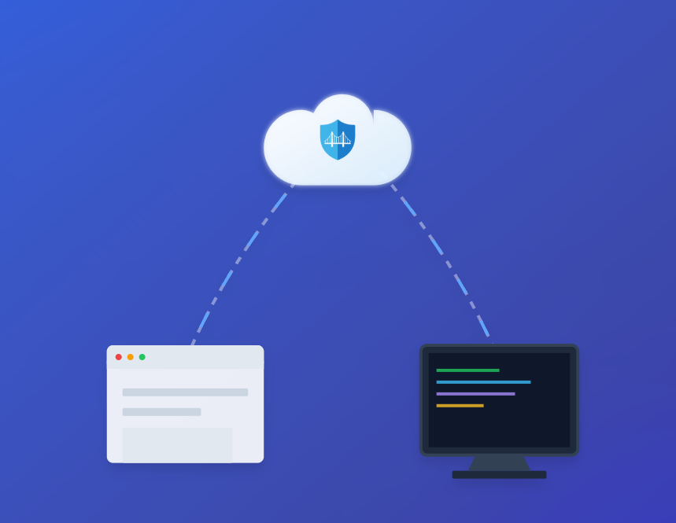
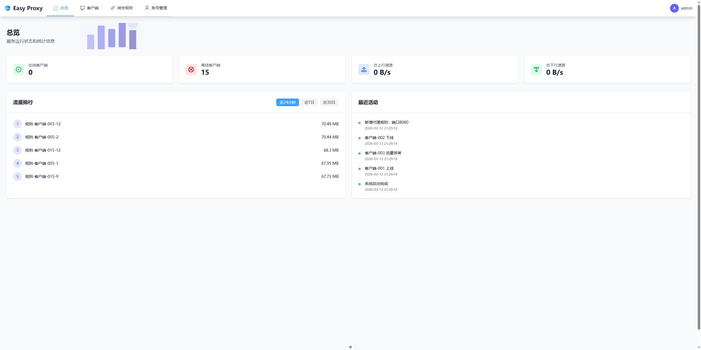
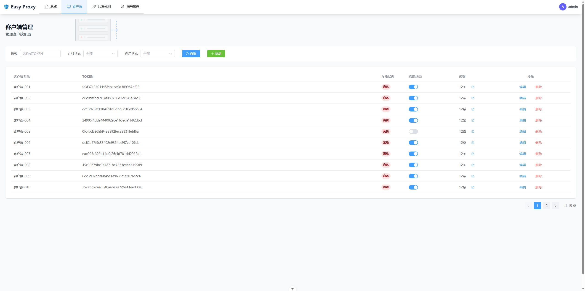

English | [中文](./README.md)

## Easy Proxy

Easy Proxy is a high-performance intranet penetration tool developed based on Java 25 native NIO and HttpServer, supporting TCP traffic forwarding. It includes a server, a client, and a Web management interface, aiming to provide easy-to-use intranet penetration services.

<p align="center">
  
</p>

## Screenshots

<p align="center">
  
  
</p>

## Core Features

| Feature | Description | Status |
| :---------- | :------------------------------------------------ | :---- |
| **TCP Intranet Penetration** | Based on Java native NIO and virtual threads, achieves high-performance TCP traffic forwarding, supports bidirectional data transparent transmission, suitable for various TCP application scenarios. | ✅ Supported |
| **TLS Encrypted Transmission** | Supports TLS encryption for server-client communication, automatically generates/downloads certificates to prevent data eavesdropping or tampering during transmission. | ✅ Supported |
| **Flow Control Management** | Supports rule-based bandwidth limiting (KB/s) and connection count limiting, adopts token bucket algorithm to precisely control traffic rate and prevent abuse. | ✅ Supported |
| **Traffic Analysis** | Provides multi-dimensional traffic statistics, supports connection monitoring and historical report queries, helping users understand traffic trends. | ✅ Supported |
| **Dynamic Port Management** | Supports dynamic application/release of ports via Web interface, taking effect in real-time without restarting the service, flexibly coping with business changes. | ✅ Supported |
| **Multi-Account Management** | Supports multi-user management, providing a visual user management interface to ensure system security. | ✅ Supported |

## Docker Quick Deployment

Images must use an immutable test tag. Replace `EASY_PROXY_VERSION` with the actual build tag.

### Server Deployment

```bash
export EASY_PROXY_VERSION=test-20261122-000000-abcdef0
export EASY_PROXY_REGISTRY=registry.cn-hangzhou.aliyuncs.com/ckyspace

docker pull ${EASY_PROXY_REGISTRY}/easy-proxy-server:${EASY_PROXY_VERSION}
docker rm -f easy-proxy-server
docker run -d \
  --name easy-proxy-server \
  --network host \
  --restart always \
  -v $(pwd)/server/server.yaml:/app/server.yaml:ro \
  -v $(pwd)/server/config:/app/config \
  -v $(pwd)/server/data:/app/data \
  -v $(pwd)/server/logs:/app/logs \
  ${EASY_PROXY_REGISTRY}/easy-proxy-server:${EASY_PROXY_VERSION}

# Web management interface
docker pull ${EASY_PROXY_REGISTRY}/easy-proxy-web:${EASY_PROXY_VERSION}
docker rm -f easy-proxy-web
docker run -d \
  --name easy-proxy-web \
  --network host \
  --restart always \
  ${EASY_PROXY_REGISTRY}/easy-proxy-web:${EASY_PROXY_VERSION}
```

#### Configuration Process

1. Open `http://server-ip:21092` in a browser.
2. Initialize the administrator account.
3. Create a client and generate its token.
4. Create a forwarding rule with the public port and client address.

### Client Deployment

```bash
export EASY_PROXY_VERSION=test-20261122-000000-abcdef0
export EASY_PROXY_REGISTRY=registry.cn-hangzhou.aliyuncs.com/ckyspace

docker pull ${EASY_PROXY_REGISTRY}/easy-proxy-client:${EASY_PROXY_VERSION}
docker rm -f easy-proxy-client
docker run -d \
  --name easy-proxy-client \
  --network host \
  --restart always \
  -v $(pwd)/client/config:/app/config \
  -v $(pwd)/client/logs:/app/logs \
  ${EASY_PROXY_REGISTRY}/easy-proxy-client:${EASY_PROXY_VERSION}
```

#### Configuration Process

1. After startup, edit `config.yaml` in the mounted `config` directory.
2. Set the server address, control port, Web port, and the client token generated by the Web UI.

```yaml
server:
  ip: "server-ip"
  port: 21090
  webPort: 21092
  token: "<WEB_UI_GENERATED_CLIENT_TOKEN>"
```

3. Restart the client to apply the configuration.

```bash
docker restart easy-proxy-client
```

## Troubleshooting

### Server or proxy service is inaccessible

- Port `21090`: TLS control channel between client and server.
- Port `21091`: server API, bound to the cloud host only.
- Port `21092`: Web UI and certificate download endpoint.
- Proxy ports: open the public ports configured in forwarding rules.

### Client cannot connect to the server

1. Verify the server address, control port, and client token.

## Tech Stack

- **Backend**: Java 25
- **Frontend**: Vue 3, TypeScript, Element Plus, Vite
- **Build Tools**: Maven, npm